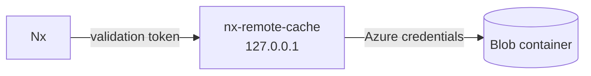
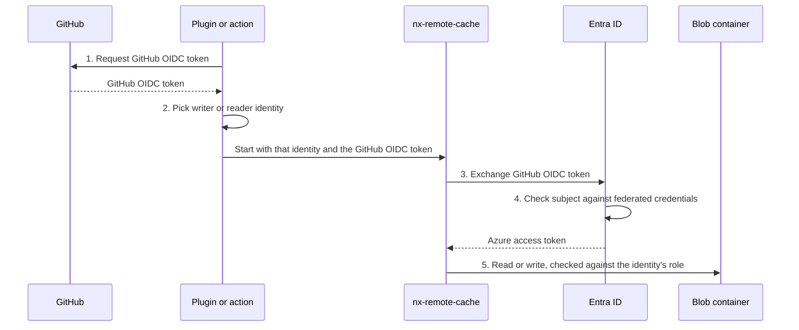
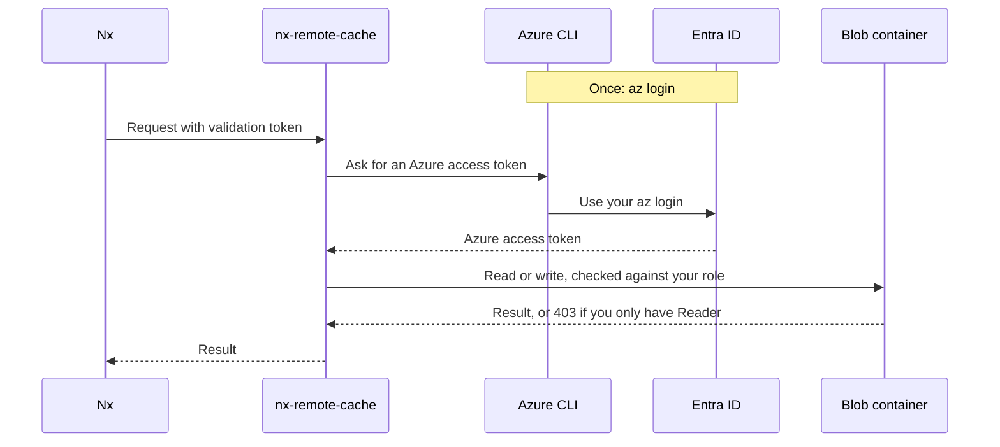

# Authentication

There are two credentials involved in every cache request:

- **A validation token**, which Nx sends to the local server.
- **Azure credentials**, which the server uses to read and write Blob Storage.



The server runs on your machine and listens on `127.0.0.1`. The validation token stops other programs on the same machine from using the server.

What a request can actually do is decided by your Azure credentials. In CI, that's the writer or reader identity the job signs in as. On a dev machine, it's your `az login`. Reader can read, Contributor can read and write, and an identity with neither role can't connect.

The validation token's scope can turn writes off, but it can't turn them on. If the validation token's scope is `read`, the server refuses uploads even when the Azure credentials could write. If its scope is `read_write`, the server still can't write unless Azure lets it. The server runs on a machine you control and could be modified, so Azure has the final say. See the [security model](security-model.md).

## Validation token

Nx reads the validation token from `NX_SELF_HOSTED_REMOTE_CACHE_ACCESS_TOKEN` and sends it as a bearer token on every request. The server's config only holds the validation token's SHA-256 hash.

Each validation token has a `name` and a `scope`. The name is recorded on every cache entry written with that validation token. The scope is `read` or `read_write`. Uploads with a `read` validation token get a `403`.

The plugin and the action generate a new validation token each time they start a server, so you don't need to manage validation tokens unless you [run the server manually](running-the-server.md). In that case, generate one with:

```sh
nx-remote-cache generate-token
```

It prints a validation token and its hash. Put the hash in the server's config, and give the validation token to Nx:

```toml
[[auth.providers]]
type = "static"
tokens = [{ name = "dev-alice", sha256 = "<sha256>", scope = "read_write" }]
```

## Azure credentials

The server uses the one auth mode set in [`storage.auth`](server-configuration.md#storage) and doesn't fall back to any other credentials.

What an identity can do depends on its role on the container. `Storage Blob Data Reader` can read. `Storage Blob Data Contributor` can read and write. The [Terraform module](../packages/terraform) creates the CI identities and assigns these roles.

### In CI

CI uses [workload identity federation](https://learn.microsoft.com/entra/workload-id/workload-identity-federation), so there are no secrets to store. The job's GitHub OIDC token is exchanged for an Azure access token for one of two Azure identities, a writer or a reader.



1. The job requests a GitHub OIDC token for the audience `api://AzureADTokenExchange`. This needs `permissions: id-token: write`. If the job doesn't have it, the plugin turns the remote cache off.
2. The plugin or action decides which identity to ask for. With `access: auto` (the default), it asks for the writer on a push to the default branch, and the reader for everything else. `access: read` and `access: write` override this.
3. The server exchanges the GitHub OIDC token with Entra ID for an Azure access token for that identity.
4. Entra ID compares the GitHub OIDC token's subject with the identity's federated credentials. The writer accepts the subjects in `writer_subjects`, such as `repo:acme/app:ref:refs/heads/main`. The reader accepts the ones in `reader_subjects`, such as `repo:acme/app:pull_request`.
5. Azure checks the identity's role on each request.

Asking for the writer in step 2 doesn't mean you get it. If a pull request sets `access: write`, Entra ID refuses the exchange in step 4 because the pull request's subject isn't in `writer_subjects`. That's how [CREEP](security-model.md#creep-cve-2025-36852) is blocked.

Jobs that use the reader identity get a `read` validation token, so their uploads fail with a `403` and Nx skips them.

The GitHub OIDC token is written to a file only the current user can read, and the server gets its path in `AZURE_FEDERATED_TOKEN_FILE`. The plugin rewrites this file on every Nx command, so a long-running server can get a new Azure access token after the old one expires.

### On a developer machine



In Docker compose, the `az` sidecar takes the Azure CLI's place.

Developers sign in with their own Azure account. When the plugin or the binary runs the server, it uses `developer_tools` mode, which picks up `az login` or `azd auth login`. The Docker compose setup uses `managed_identity` mode instead, pointed at an `az` sidecar that hands out Azure access tokens from your `az login`. The sidecar isn't published to the host, only issues access tokens for Azure Storage, and requires a shared secret that `scripts/dev-compose.sh` generates the first time you run it.

Outside CI, the plugin gives Nx a `read_write` validation token, so whether you can write depends on your role on the container. The Terraform module gives Reader to the groups in `reader_group_object_ids` and Contributor to `writer_group_object_ids`. With Reader only, your uploads get a `403` and Nx skips them. Read [Developer writes](security-model.md#developer-writes) before giving anyone write access.

### Other environments

Use `managed_identity` on a host that has an Azure managed identity, such as a VM or a container app. Use `workload_identity` with any other OIDC provider that's federated with Entra ID, by pointing `AZURE_FEDERATED_TOKEN_FILE` at that provider's OIDC token. Use `client_secret` for a service principal. The config names the environment variable that holds the secret, and the secret stays out of the config.

## Upload attribution

Each blob records the name of the validation token that wrote it:

| Writer                  | Name                       |
| ----------------------- | -------------------------- |
| Plugin in CI            | `ci-<repository>-<run id>` |
| Plugin on a dev machine | `dev-<username>`           |
| GitHub Action           | `ci-job`                   |
| Manual config           | The `name` you set         |

> [!WARNING]
> Don't trust this name. It's a convenience for spotting where an entry probably came from, not a security feature. Whoever starts the server picks the name, so anyone with write access can record any name they like. To find out which identity really wrote an entry, use Azure's storage logs.
