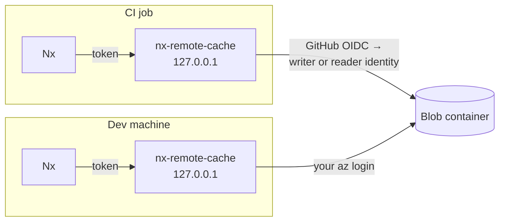

# How it works

The cache storage is shared, but the server isn't. Every CI job and developer uses the same Azure Blob Storage container, so an entry written by one of them is a cache hit for all the others. However, the server that talks to that container is not a shared service: each CI job and each developer runs their own private instance on their own machine, usually started by the [Nx plugin](../packages/nx-plugin).

Each instance listens on `127.0.0.1` and implements Nx's [self-hosted cache API](https://nx.dev/docs/kb/self-hosted-caching), so Nx talks to it like any other remote cache. The instance reads and writes the shared container directly, with the Azure credentials of whoever started it.

The only infrastructure you deploy is the storage container and the Azure identities that can use it. See [Deploying to Azure](deploy.md).

## Authentication

Nx authenticates to the local server with a token that is made up when the server starts. The server authenticates to Azure with the caller's own identity: a GitHub OIDC token exchanged for the writer or reader identity in CI, or your `az login` on a dev machine. No secrets are stored anywhere.

Azure's role assignments decide who can write, not the server. See [Authentication](authentication.md) for the full flow.

## Storage

Each cache entry is a blob named after its task hash, under the configured [`prefix`](server-configuration.md#storage).

Uploads and downloads stream. Large uploads are sent to Azure in 8 MiB blocks and committed with `If-None-Match: *`, so an existing entry is never replaced. Downloads are fetched as parallel range requests. Memory use stays around 30 MB per upload and 90 MB per download, whatever the artifact size.

Every blob records the name of the token that wrote it. See [Upload attribution](authentication.md#upload-attribution).

## Behaviour

The server checks storage access before it starts listening. If the container is missing, or the identity can't be obtained or has no role on it, the server exits with an error that says so. Once `/health` responds, the server is ready to serve requests.

| Response | When                                         |
| -------- | -------------------------------------------- |
| `401`    | The token is missing or wrong                |
| `403`    | An upload from a read-only token or identity |
| `409`    | An upload for a hash that is already cached  |
| `413`    | An upload larger than `max_artifact_bytes`   |

Nx treats a `401` as fatal, so a misconfigured token fails the run even if every task passed. A `403` on upload is not fatal, and Nx carries on without uploading. The server reads the whole request body before it returns a `403`, so Nx sees the status code instead of a dropped connection.
