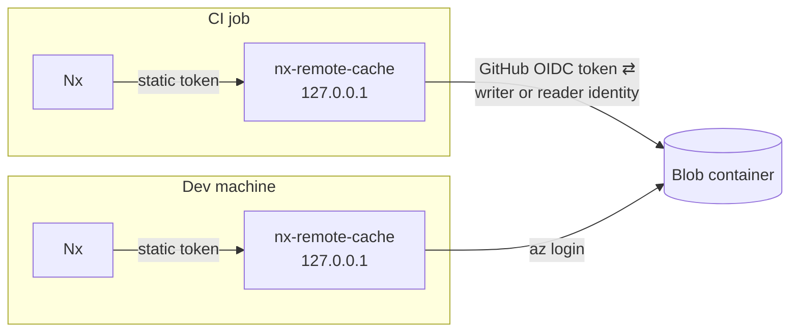

# How it works

Each CI job and each developer runs their own instance of the server. Nx talks to that local instance, and the instance talks to Azure Blob Storage with the caller's identity.

## Nx to the server

Nx sends a static token with every request. The server stores tokens as SHA-256 hashes in its config. In CI, the action generates a new token for each job.

The server only listens on `127.0.0.1`, so the token's job is to keep other local processes out. Each token has a scope of `read` or `read_write`. Uploads with a `read` token get a `403`, and Nx skips them.

## The server to Azure

The server uses the single auth mode named in [`storage.auth`](configuration.md#storage). It does not fall back to other credentials.

| Where it runs           | `storage.auth.mode`                                                                                |
| ----------------------- | -------------------------------------------------------------------------------------------------- |
| CI job                  | `workload_identity`, which exchanges the job's GitHub OIDC token for the writer or reader identity |
| Docker on a dev machine | `managed_identity` through the `az` sidecar                                                        |
| Binary on a dev machine | `developer_tools`, which uses your `az login`                                                      |
| Anywhere else           | `client_secret`, which uses a service principal                                                    |

The identity's role on the container controls whether or not the request can read or write. Azure Identities with `Storage Blob Data Reader` can only read. `Storage Blob Data Contributor` can read and write. Shared keys and connection strings are not supported.

## Behaviour

Nx treats a `401` from the cache as fatal, so an invalid token fails the run even if every task passed. A `403` on upload is not fatal, and Nx carries on without uploading. The server reads the whole request body before it rejects an upload, so Nx sees the `403` instead of a dropped connection.

Uploads and downloads stream. Large uploads are sent to Azure in 8 MiB blocks and committed with `If-None-Match: *`, so an existing entry is never replaced. Memory use stays around 30 MB per upload and 90 MB per download, whatever the artifact size.

Every blob records the name of the token that wrote it. The action uses `ci-job`, and the dev compose setup uses `dev-<username>`.

The server checks storage access before it starts listening. If the container is missing, a role assignment is missing or the SAS has expired, it exits with an error that says so. Once `/health` responds, the server is ready to serve requests.
